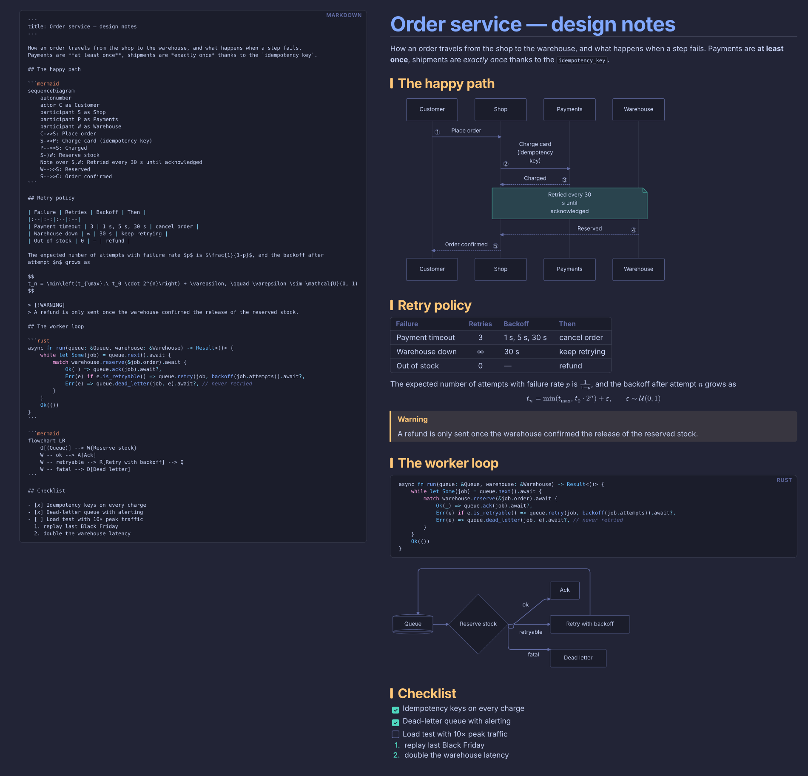
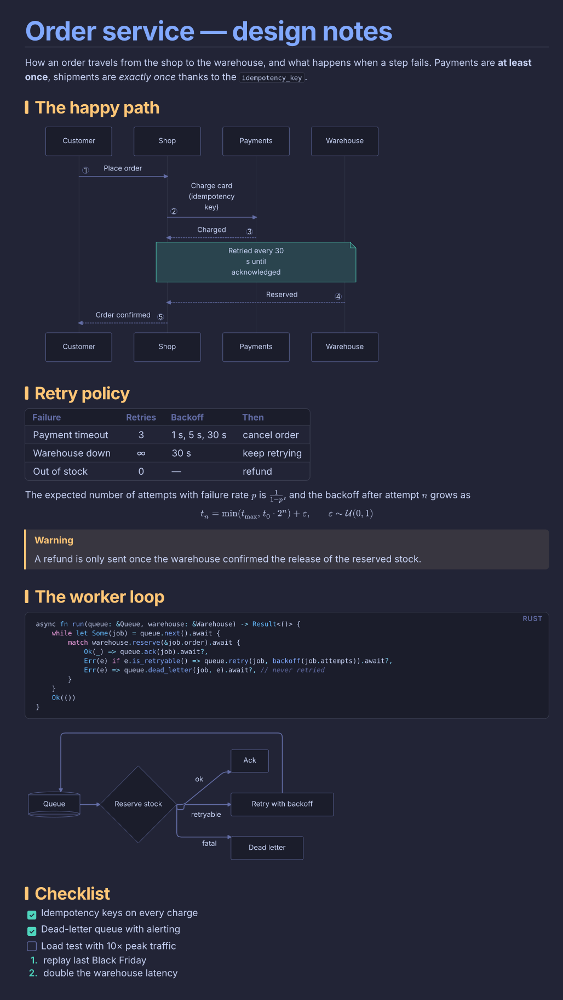
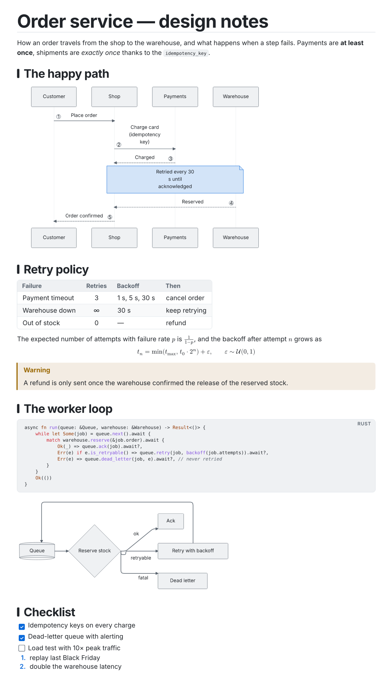

# typeset.nvim

A live, typeset preview of markdown in a split next to your buffer: real font sizes for
headings, tables with borders, LaTeX math, mermaid diagrams, code with your colourscheme. The
preview follows the buffer you are in and scrolls with your cursor, like a browser preview but
drawn in the terminal with the kitty graphics protocol.

No browser, no Node, no LaTeX, no system fonts. Rendering is done by a small standalone binary
built on [typst](https://typst.app) (fonts embedded), a pure-Rust mermaid renderer and a LaTeX →
typst math converter.

Your buffer stays plain text: nothing in it is replaced or hidden. While you edit a block the
preview keeps its previous image until the new one is rendered, so it never flickers.

**Inline mode** (`:Typeset inline`, or `inline = { enabled = true }`) typesets headings, tables
and mermaid diagrams in the buffer itself, the way Emacs shows images and scaled headings in
place; the block under the cursor shows as source, so you edit markdown and read typeset text in
one window. See `:help typeset-inline` for its limits.

## Screenshots



| Dark (tokyonight-moon colours) | Light (GitHub colours) |
|---|---|
|  |  |

[docs/demo.md](docs/demo.md) rendered by `typeset-renderer`: the same images the preview shows,
laid on the theme's background (the source pane is the markdown drawn as a code block).
Regenerate them with `python3 docs/screenshots.py`.

## Requirements

- Neovim 0.12+ (`nvim_ui_send`) with `termguicolors` and the treesitter `markdown` parser
- a terminal with kitty graphics **unicode placeholders**: kitty or ghostty (also inside herdr)
- the terminal on the same machine as Neovim (images are passed as file paths)

`:checkhealth typeset` checks all of it. Full documentation: `:help typeset`.

## Install (lazy.nvim)

```lua
{
  "nmannaii/typeset.nvim",
  ft = "markdown",
  build = function()
    require("typeset.build").install({ sync = true })
  end,
  opts = {},
}
```

`:TypesetInstall` downloads the prebuilt renderer for your platform from this repository's
releases, and builds it with `cargo` when there is none (a few minutes the first time).

## Commands

| Command | |
|---|---|
| `:Typeset` | open / close the preview (`q` in the preview closes it too) |
| `:Typeset inline` | turn the inline mode on / off in the current buffer |
| `:Typeset rerender` | clear the image cache and render again |
| `:TypesetInstall` | download or build the renderer |

## Configuration

```lua
require("typeset").setup({
  filetypes = { "markdown" },
  preview = { position = "right", size = 0.45 }, -- size: fraction of the editor, or cells
  inline = {
    enabled = false,                          -- inline mode in every markdown buffer
    kinds = { "heading", "table", "mermaid" }, -- or "all"
    scrolloff = 1,       -- most 'scrolloff' of windows showing an inline buffer
    scroll_fix = true,   -- <C-e>, <C-y> and the wheel scroll the plugin's way (Nvim 0.12 bug)
    reveal_delay = 100,  -- ms the cursor rests in a block before it shows as source
  },
  max_width = 120,   -- cells
  text_scale = 0.72, -- body text size / cell height
  debounce = 150,    -- ms after an edit
  cell = nil,        -- { w, h } pixels; nil = measured from the terminal
  font = "Inter",    -- or "Libertinus Serif", "New Computer Modern"
  mono_font = "DejaVu Sans Mono",
  theme = nil,       -- table merged into, or function(theme) returning, the colours
  binary = nil,      -- path to typeset-renderer
  repo = "nmannaii/typeset.nvim", -- where prebuilt binaries are downloaded from
})
```

Colours come from your colourscheme (`Normal`, heading groups, `Comment`, links, and the syntax
groups for code blocks), so the preview follows it, `:colorscheme` changes included.

## How it works

1. treesitter splits the buffer into top-level blocks.
2. Each block is sent to `typeset-renderer` (one long-running process, JSON lines on
   stdin/stdout). It converts the markdown to typst, renders mermaid to SVG and LaTeX math with
   mitex, compiles, and writes a PNG as wide as the preview, trimmed to its content and padded
   to whole cells. Typst memoizes between requests; PNGs are cached on disk by content hash.
   Renders run one at a time, blocks on screen first, and renders made stale by further edits
   are dropped before they start.
3. Each PNG is sent to the terminal once (`t=f`: by path) with a virtual placement; the preview
   buffer is made of U+10EEEE placeholder cells whose colour carries the image id, block after
   block, so the terminal draws the images wherever the preview window shows them.

## License

MIT, see [LICENSE](LICENSE). Bundled third-party code and fonts keep their own licenses, see
[THIRD_PARTY.md](THIRD_PARTY.md).
