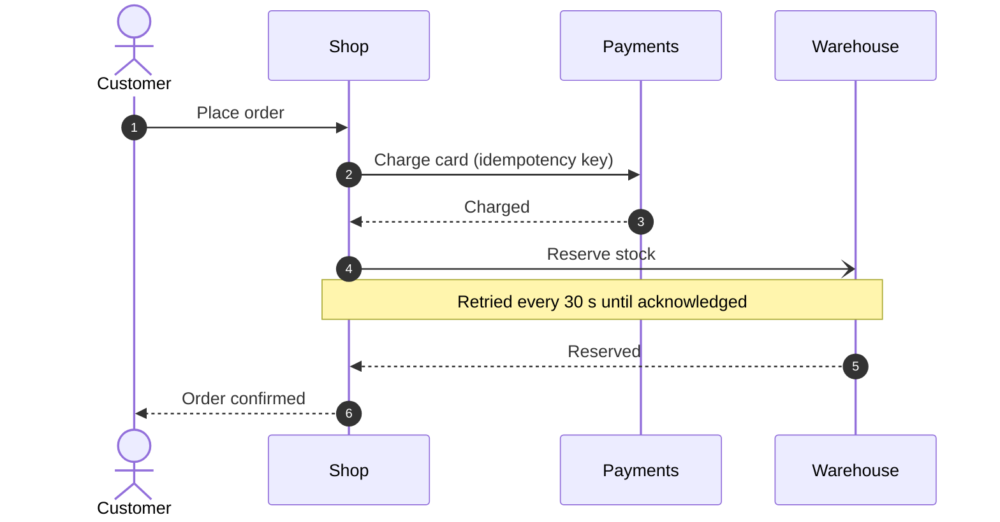
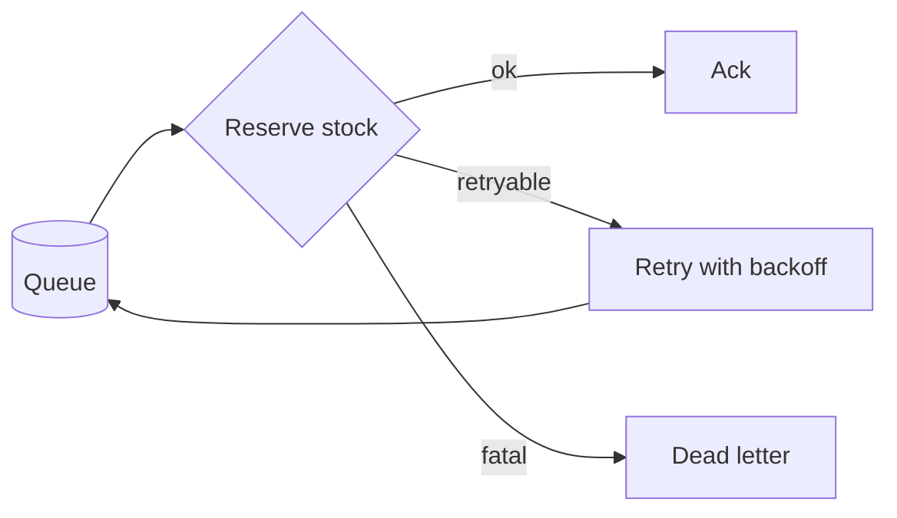

How an order travels from the shop to the warehouse, and what happens when a step fails.
Payments are **at least once**, shipments are *exactly once* thanks to the `idempotency_key`.

## The happy path



## Retry policy

| Failure | Retries | Backoff | Then |
|:--|:-:|:--|:--|
| Payment timeout | 3 | 1 s, 5 s, 30 s | cancel order |
| Warehouse down | ∞ | 30 s | keep retrying |
| Out of stock | 0 | — | refund |

The expected number of attempts with failure rate $p$ is $\frac{1}{1-p}$, and the backoff after
attempt $n$ grows as

$$
t_n = \min\left(t_{\max},\ t_0 \cdot 2^{n}\right) + \varepsilon, \qquad \varepsilon \sim \mathcal{U}(0, 1)
$$

> [!WARNING]
> A refund is only sent once the warehouse confirmed the release of the reserved stock.

## The worker loop

```rust
async fn run(queue: &Queue, warehouse: &Warehouse) -> Result<()> {
    while let Some(job) = queue.next().await {
        match warehouse.reserve(&job.order).await {
            Ok(_) => queue.ack(job).await?,
            Err(e) if e.is_retryable() => queue.retry(job, backoff(job.attempts)).await?,
            Err(e) => queue.dead_letter(job, e).await?, // never retried
        }
    }
    Ok(())
}
```



## Checklist

- [x] Idempotency keys on every charge
- [x] Dead-letter queue with alerting
- [ ] Load test with 10× peak traffic
  1. replay last Black Friday
  2. double the warehouse latency
